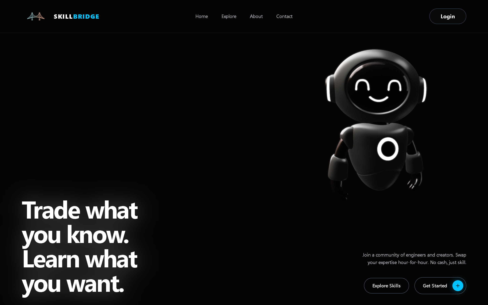
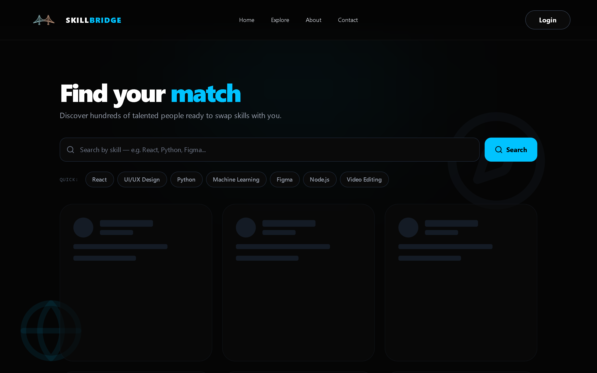
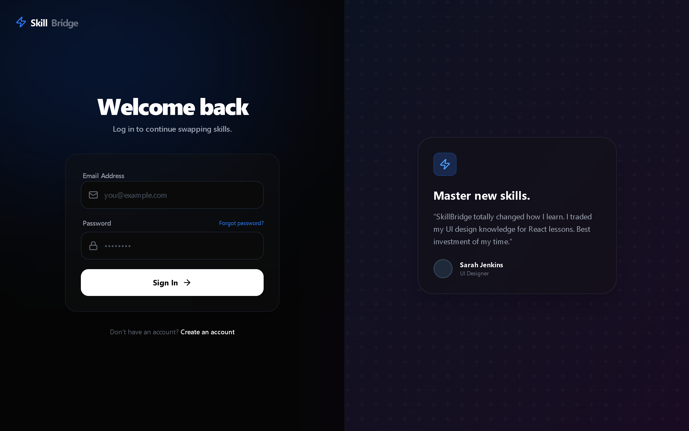
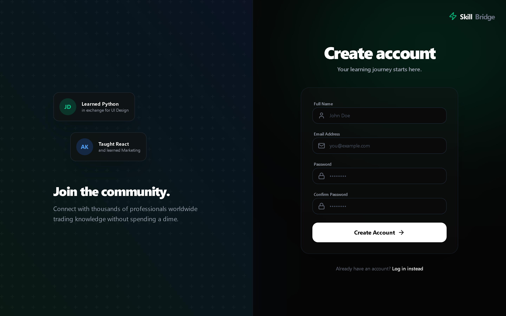
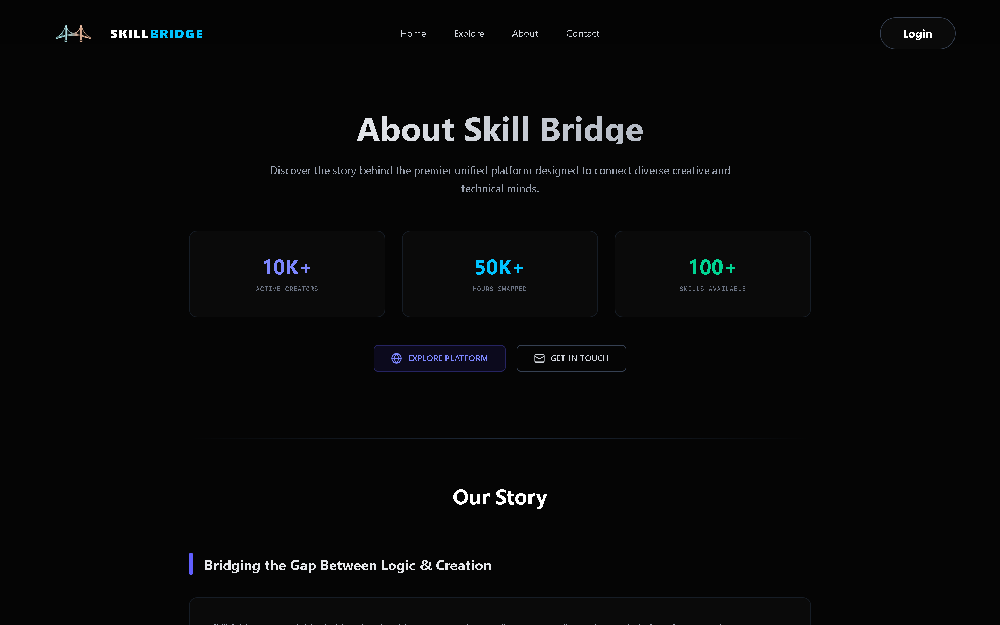
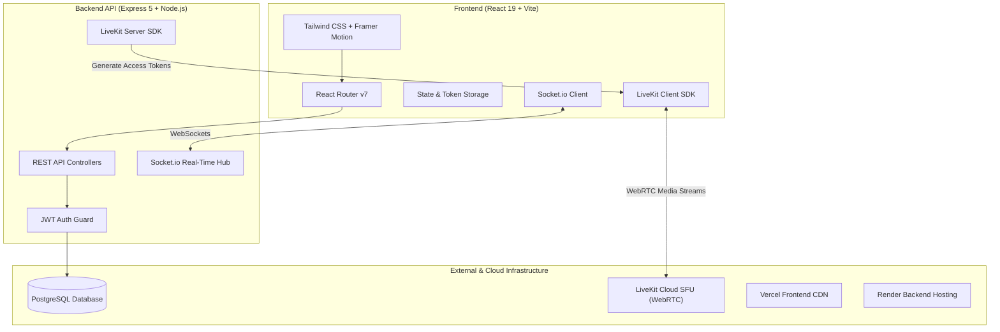
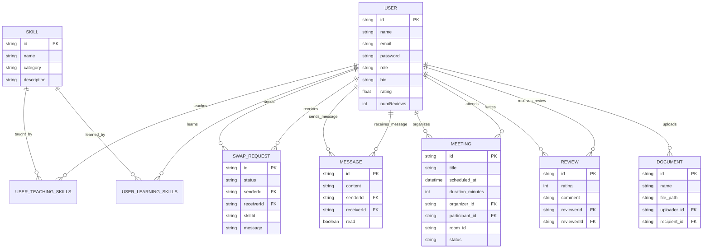

<div align="center">

# 🌉 SkillBridge

### **Next-Generation Peer-to-Peer Skill Exchange & Collaborative Learning Platform**

Connect learners and mentors across the globe to exchange knowledge, schedule interactive sessions, collaborate in real time, and hold HD video calls.

[](https://skill-bridge-sigma-sable.vercel.app)
[](https://skill-bridge-zcin.onrender.com)
[](LICENSE)

<br/>

[](https://react.dev/)
[](https://vitejs.dev/)
[](https://tailwindcss.com/)
[](https://nodejs.org/)
[](https://expressjs.com/)
[](https://www.postgresql.org/)
[](https://www.prisma.io/)
[](https://livekit.io/)
[](https://socket.io/)

---

[🌐 Live Application](https://skill-bridge-sigma-sable.vercel.app) • [📡 Backend API](https://skill-bridge-zcin.onrender.com) • [🐛 Report Bug](https://github.com/Yogesh5201/Skill_Bridge/issues) • [✨ Request Feature](https://github.com/Yogesh5201/Skill_Bridge/issues)

</div>

<br/>

## 📖 Table of Contents

- [Overview](#-overview)
- [Key Features](#-key-features)
- [UI Showcase & Screenshots](#-ui-showcase--screenshots)
- [Architecture](#-architecture)
- [Tech Stack](#-tech-stack)
- [Database Schema](#-database-schema)
- [Getting Started](#-getting-started)
  - [Prerequisites](#prerequisites)
  - [Backend Setup](#1-backend-setup)
  - [Frontend Setup](#2-frontend-setup)
- [Environment Variables](#-environment-variables)
- [API Reference](#-api-reference)
- [Real-Time Signaling & Video](#-real-time-signaling--video)
- [Project Structure](#-project-structure)
- [Deployment](#-deployment)
- [Contributing](#-contributing)
- [License](#-license)

---

## 🚀 Overview

**SkillBridge** is a full-stack, real-time peer mentorship and skill-exchange web application designed to democratize learning. Instead of expensive paywalled courses, SkillBridge allows people with complementary skills to match with each other—teach what you know, learn what you love.

Whether you're a developer teaching React in exchange for Python AI mentoring, or a graphic designer trading UI/UX tips for SEO strategies, SkillBridge provides the end-to-end infrastructure: **interactive search, real-time swap requests, instant chat, document sharing, meeting scheduling, and built-in HD video/audio conferencing**.

---

## ✨ Key Features

- **🎯 Skill Matching & Discovery**
  - Search skills across Web Development, AI, Mobile, Design, Marketing, and more.
  - View mentor profiles, bio, teaching skills, skills they want to learn, and peer ratings.
  
- **📹 Production-Grade HD Video Calls (LiveKit)**
  - Seamless in-browser video meetings powered by **LiveKit SFU WebRTC**.
  - Camera & microphone toggling, screen sharing, speaker layout, and participant management.
  - Dynamic meeting tokens generated securely on the server.

- **🔔 Global Incoming Call Alert**
  - Instant popup notification anywhere across the app when another user initiates a call with you.
  - One-click Accept or Decline with automated real-time status notifications.

- **💬 Real-Time Messaging (Socket.IO)**
  - Instant one-on-one messaging with live presence indicators.
  - Persistent message history stored in PostgreSQL.

- **📅 Mentorship Session Scheduling**
  - Schedule upcoming mentorship sessions with custom dates, durations, and agenda notes.
  - One-click launch into dedicated meeting rooms.

- **📂 Document & Resource Sharing**
  - Upload and exchange learning materials, study notes, guides, and project assignments securely.

- **⭐ Reputation & Review System**
  - Rate peer sessions from 1 to 5 stars and leave authentic feedback.
  - Automatically aggregated mentor ratings to build trust in the community.

- **🛡️ Secure Authentication & Role-Based Access**
  - JSON Web Token (JWT) based authentication with salted bcrypt password hashing.
  - Protected API routes, client route guards, and Admin moderation dashboard.

- **🎨 Modern Dark Glassmorphic Design**
  - Built with Tailwind CSS v4, Framer Motion animations, Spline 3D elements, and responsive mobile-ready layouts.

---

## 📸 UI Showcase & Screenshots

### 🌟 1. Landing Page & Hero Section
*Sleek, futuristic landing page introducing the platform, mission, and interactive features.*


<br/>

### 🔍 2. Explore & Discover Mentors
*Find community members, browse skills they teach, see what they want to learn, and connect instantly.*


<br/>

### 🔐 3. User Authentication (Login & Signup)
*Secure, fast, and elegant JWT-based authentication system.*
<div align="center">
  
  
</div>

<br/>

### 💡 4. About & Community Mission
*Transparent breakdown of SkillBridge's vision, core values, and community impact.*


---

## 🏗️ Architecture



---

## 🛠️ Tech Stack

### **Frontend**
| Technology | Purpose |
| :--- | :--- |
| **React 19** | Core UI component framework |
| **Vite 7** | Lightning-fast next-gen build tool & dev server |
| **Tailwind CSS v4** | Modern utility-first styling with sleek dark-mode aesthetics |
| **Framer Motion 12** | Smooth UI micro-interactions, modals, and route transitions |
| **LiveKit Components** | Production-ready WebRTC audio/video call UI and track management |
| **Socket.IO Client** | Real-time WebSocket connection for instant chat & incoming call alerts |
| **Lucide React** | Clean, lightweight icon suite |
| **Axios** | HTTP client with automatic JWT authorization header interceptors |
| **Spline 3D** | Interactive 3D graphics & visual models |

### **Backend**
| Technology | Purpose |
| :--- | :--- |
| **Node.js** | JavaScript runtime environment |
| **Express 5** | High-performance backend web framework |
| **PostgreSQL** | Robust relational database for users, skills, sessions, and messages |
| **Prisma ORM & pg** | Type-safe database queries, connection pooling, and schema management |
| **Socket.IO** | WebSocket server powering instant messaging, signaling, and presence |
| **LiveKit Server SDK** | Video room token generation, grant verification, and session control |
| **JWT & bcryptjs** | Stateless token auth & cryptographic password hashing |
| **Multer** | Multipart file upload management for documents and avatars |

---

## 🗄️ Database Schema

The PostgreSQL database manages relations between users, skills, swap requests, meetings, messages, and reviews:



---

## ⚡ Getting Started

Follow these steps to run SkillBridge locally on your development machine.

### Prerequisites
- [Node.js](https://nodejs.org/) (v18.0.0 or higher recommended)
- [npm](https://www.npmjs.com/) or [yarn](https://yarnpkg.com/)
- [PostgreSQL](https://www.postgresql.org/) database (local or hosted e.g. Neon, Supabase, Render)
- [LiveKit Cloud Account](https://cloud.livekit.io/) *(free tier available for video conferencing)*

---

### 1. Backend Setup

```bash
# Clone the repository
git clone https://github.com/Yogesh5201/Skill_Bridge.git
cd Skill_Bridge

# Navigate into the server directory
cd server

# Install dependencies
npm install

# Create environment configuration file
cp .env.example .env
```

Edit `server/.env` with your credentials:
```env
PORT=5000
DATABASE_URL="postgresql://<user>:<password>@<host>:<port>/<dbname>?sslmode=require"
JWT_SECRET="your_super_secret_jwt_key_change_in_production"
FRONTEND_URL="http://localhost:5173"

# LiveKit Video Calling Credentials
LIVEKIT_URL="wss://your-project.livekit.cloud"
LIVEKIT_API_KEY="your_livekit_api_key"
LIVEKIT_API_SECRET="your_livekit_api_secret"
```

Initialize the database schema and seed default skills:
```bash
# Run the database initialization / migrations
npm start
```
*(The server auto-initializes junction tables and pre-seeds essential skills upon boot).*

Start the development server with live reload:
```bash
npm run dev
```
Backend will be live at `http://localhost:5000`.

---

### 2. Frontend Setup

In a new terminal:
```bash
# Navigate to client directory
cd client

# Install frontend dependencies
npm install

# (Optional) Create local env file if customizing API endpoint
echo "VITE_API_URL=http://localhost:5000" > .env.local

# Start Vite dev server
npm run dev
```
Open your browser at `http://localhost:5173` to explore SkillBridge!

---

## 🔐 Environment Variables

### **Backend (`server/.env`)**
| Key | Required | Description |
| :--- | :---: | :--- |
| `PORT` | No | Server port (defaults to `5000`) |
| `DATABASE_URL` | Yes | PostgreSQL connection string |
| `JWT_SECRET` | Yes | Cryptographic secret for signing auth tokens |
| `FRONTEND_URL` | No | Allowed frontend origin for CORS |
| `LIVEKIT_URL` | Yes | LiveKit server websocket URL (`wss://...`) |
| `LIVEKIT_API_KEY` | Yes | LiveKit project API key |
| `LIVEKIT_API_SECRET` | Yes | LiveKit project API secret key |

### **Frontend (`client/.env`)**
| Key | Required | Description |
| :--- | :---: | :--- |
| `VITE_API_URL` | No | API backend URL (defaults to production Render URL in prod, `http://localhost:5000` in dev) |
| `VITE_LIVEKIT_URL` | No | Direct LiveKit websocket address override |

---

## 📡 API Reference

### 🔑 Authentication
| Method | Endpoint | Description | Protected |
| :--- | :--- | :--- | :---: |
| `POST` | `/api/auth/register` | Register a new user account | No |
| `POST` | `/api/auth/login` | Authenticate and obtain JWT token | No |
| `GET` | `/api/auth/me` | Fetch authenticated user's profile | Yes |

### 👤 Users & Profiles
| Method | Endpoint | Description | Protected |
| :--- | :--- | :--- | :---: |
| `GET` | `/api/users` | List all platform users | No |
| `GET` | `/api/users/:id` | Fetch specific user details and skills | No |
| `PUT` | `/api/users/profile` | Update profile bio, avatar, and summaries | Yes |

### 🎯 Skills & Categories
| Method | Endpoint | Description | Protected |
| :--- | :--- | :--- | :---: |
| `GET` | `/api/skills` | List all available skills | No |
| `POST` | `/api/skills/teach` | Add a skill to your teaching list | Yes |
| `POST` | `/api/skills/learn` | Add a skill to your learning wishlist | Yes |
| `DELETE` | `/api/skills/:id` | Remove skill from teaching/learning | Yes |

### 🔄 Swap Requests & Sessions
| Method | Endpoint | Description | Protected |
| :--- | :--- | :--- | :---: |
| `GET` | `/api/requests` | List user's incoming & outgoing swap requests | Yes |
| `POST` | `/api/requests` | Send a new skill exchange request | Yes |
| `PUT` | `/api/requests/:id/status` | Accept, reject, or mark request completed | Yes |

### 📹 LiveKit & Video Meetings
| Method | Endpoint | Description | Protected |
| :--- | :--- | :--- | :---: |
| `POST` | `/api/livekit/token` | Generate signed LiveKit token for video room | Yes |
| `GET` | `/api/meetings` | List scheduled meetings | Yes |
| `POST` | `/api/meetings` | Schedule a new mentorship meeting | Yes |
| `DELETE` | `/api/meetings/:id` | Cancel a scheduled meeting | Yes |

### 💬 Messages & Documents
| Method | Endpoint | Description | Protected |
| :--- | :--- | :--- | :---: |
| `GET` | `/api/messages/:userId`| Fetch chat history with specific user | Yes |
| `POST` | `/api/messages` | Send message (also triggers Socket.IO) | Yes |
| `POST` | `/api/documents/upload`| Upload resource/document (via Multer) | Yes |
| `GET` | `/api/documents` | List shared documents | Yes |

---

## 📹 Real-Time Signaling & Video

SkillBridge leverages a dual-engine architecture for real-time collaboration:

1. **Socket.IO Real-Time Signal Hub:**
   - **User Presence:** Track online/offline status.
   - **Incoming Video Call Alert:** Emits `webrtc:incoming-call` with the caller's identity so the recipient receives an instant modal prompt anywhere in the app.
   - **Call Responses:** Handles `webrtc:accept-call` and `webrtc:reject-call` seamlessly.

2. **LiveKit Cloud WebRTC SFU:**
   - Upon call acceptance, both participants receive cryptographic room tokens from `/api/livekit/token`.
   - Ultra-low latency, scalable Selective Forwarding Unit (SFU) audio and video streams.
   - Integrated device controls, mute/unmute, screen-share, and responsive participant grids.

---

## 📂 Project Structure

```
skill-bridge/
├── client/                      # React 19 Frontend
│   ├── public/                  # Static assets & brand logos
│   │   └── logo.png
│   ├── src/
│   │   ├── api/                 # Axios API clients & interceptors
│   │   │   ├── authApi.js
│   │   │   ├── client.js
│   │   │   ├── meetingApi.js
│   │   │   └── ...
│   │   ├── components/          # Reusable UI components
│   │   │   ├── ChatBox.jsx
│   │   │   ├── IncomingCallNotification.jsx
│   │   │   ├── MeetingModal.jsx
│   │   │   ├── Navbar.jsx
│   │   │   ├── SkillCard.jsx
│   │   │   └── VideoCallModal.jsx
│   │   ├── pages/               # Application view routes
│   │   │   ├── Home.jsx
│   │   │   ├── Explore.jsx
│   │   │   ├── Dashboard.jsx
│   │   │   ├── Login.jsx
│   │   │   ├── Register.jsx
│   │   │   ├── UserProfile.jsx
│   │   │   ├── About.jsx
│   │   │   └── Contact.jsx
│   │   ├── App.jsx              # Main router & global socket listeners
│   │   └── main.jsx
│   ├── index.html
│   ├── vite.config.js
│   └── vercel.json
│
├── server/                      # Express 5 Backend API
│   ├── controllers/             # Request handlers & logic
│   ├── db/                      # Database pool & initialization scripts
│   │   ├── initDb.js
│   │   └── pool.js
│   ├── middleware/              # Auth & upload middlewares
│   ├── prisma/                  # Prisma schema definition
│   │   └── schema.prisma
│   ├── routes/                  # Express route definitions
│   │   ├── authRoutes.js
│   │   ├── livekitRoutes.js
│   │   ├── meetingRoutes.js
│   │   ├── messageRoutes.js
│   │   └── ...
│   ├── uploads/                 # Static uploads directory
│   ├── app.js                   # Server entrypoint & Socket.IO config
│   └── package.json
│
├── screenshots/                 # Application UI screenshots for docs
│   ├── landing.png
│   ├── explore.png
│   ├── login.png
│   ├── register.png
│   └── about.png
├── LICENSE
└── README.md
```

---

## 🌐 Deployment

SkillBridge is built for effortless cloud deployment:

- **Frontend on [Vercel](https://vercel.com):**
  - Continuous deployment configured via `client/vercel.json` with SPA route rewrites.
  - Deployed URL: [https://skill-bridge-sigma-sable.vercel.app](https://skill-bridge-sigma-sable.vercel.app)

- **Backend on [Render](https://render.com):**
  - Hosted Node.js web service running `npm start`.
  - Deployed URL: [https://skill-bridge-zcin.onrender.com](https://skill-bridge-zcin.onrender.com)

- **Database:**
  - Hosted cloud PostgreSQL with SSL encryption.

---

## 🤝 Contributing

Contributions make the open-source community an inspiring place to learn, inspire, and create. Any contributions you make are **greatly appreciated**!

1. **Fork the Project**
2. **Create your Feature Branch** (`git checkout -b feature/AmazingFeature`)
3. **Commit your Changes** (`git commit -m 'feat: add some amazing feature'`)
4. **Push to the Branch** (`git push origin feature/AmazingFeature`)
5. **Open a Pull Request**

---

## 📄 License

Distributed under the **MIT License**. See [`LICENSE`](LICENSE) for more information.

---

<div align="center">

Made with ❤️ by [Yogesh Kumar](https://github.com/Yogesh5201) and contributors.

⭐ **If you like this project, please consider giving it a star on [GitHub](https://github.com/Yogesh5201/Skill_Bridge)!**

</div>
